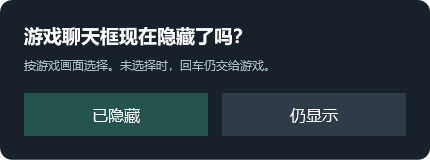
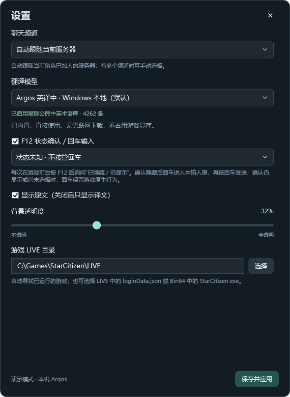

# 星际公民聊天翻译 · SCChatTranslator

Windows 独立聊天翻译浮窗：读取当前角色已加入的公开服务器频道，显示原文和简体中文译文；也支持输入中文，自动翻译为英文后发送。

**无需修改游戏，无需安装 Python。** 默认使用内置本地模型，也可选择 Windows 本地 Hy-MT3，或连接 Mac / 其他服务器上的翻译 API。

**[下载最新版 EXE](https://github.com/LouieLumi/SCChatTranslator/releases/latest/download/SCChatTranslator.exe)** · [全部版本与校验文件](https://github.com/LouieLumi/SCChatTranslator/releases) · [离线配图说明](https://github.com/LouieLumi/SCChatTranslator/releases/latest/download/usage.html)


*配图为本程序的独立演示界面，使用示例消息，不含真实玩家聊天或登录信息。*

## 功能

- 读取当前账号已加入的公开服务器聊天，显示原文和中文译文；已有中文及兼容汉化编码直接显示中文。
- 黑色透明浮窗、可调背景透明度、移动与缩放、锁定置顶、系统托盘后台运行。
- “中 / 英”点击切换，回车打开输入框、发送或收起，切换窗口保留未发送草稿。
- F12 每次确认原生聊天框状态；原生聊天框显示时保留游戏输入，隐藏时可使用本程序输入。
- 内置 Argos 中英双向模型与 4,262 条精选游戏术语，支持本地 Hy-MT3 及自定义翻译 API。
- 滚动条只在鼠标滚轮滚动时显示，停止 3 秒后淡出；消息自动滚动不会显示滚动条。

## 下载与开始使用

运行环境：**Windows 10 / 11 x64**，已安装并正常登录《星际公民》。建议游戏使用**无边框窗口**模式。

1. 在 [最新 Release](https://github.com/LouieLumi/SCChatTranslator/releases/latest) 下载 **SCChatTranslator.exe**。无需下载源码 ZIP，也无需手动安装 Python。
2. 使用 RSI Launcher 正常登录并进入游戏服务器。
3. 双击 EXE。首次打开会准备内置运行环境和模型，等待进度完成；之后直接启动。
4. 程序自动寻找运行中的游戏目录。没有识别到时，打开右上角齿轮，在“游戏 LIVE 目录”中选择 LIVE 下的 `loginData.json`，或 `Bin64` 下的 `StarCitizen.exe`。
5. 默认使用“自动跟随当前服务器”。账号返回多个公开频道时，在设置中手动选择对应频道。

更新时，用新版 EXE 替换旧版再启动，原有设置保留。离线配图说明 `usage.html` 的图片已内嵌，下载后可用浏览器直接打开。

## 窗口与滚动

| 操作 | 作用 |
|---|---|
| 齿轮按钮 | 打开频道、翻译模型、原文显示、透明度及快捷键设置 |
| 锁图标 | 点击锁定 / 解锁位置；解锁后拖动窗口上沿移动，拖动边缘缩放；两种状态均保持置顶 |
| 右上角 × | 隐藏到系统托盘，继续后台读取 |
| 托盘图标 | 双击恢复窗口；右键可显示窗口、打开设置或彻底退出。图标可能位于 Windows 的 `^` 隐藏图标列表中 |
| 鼠标移到右上角按钮处 | 三个按钮淡入；离开 3 秒后淡出 |
| 鼠标滚轮 | 滚动查看历史，同时显示细滚动条；停止 3 秒后淡出 |
| “↓ 最新” | 回到最新消息；自动滚动不会唤出滚动条 |

设置里的“显示原文”可隐藏外语原文；中文消息仍直接显示。透明度只影响背景，文字保持清晰。

## 输入与发送


输入框默认隐藏。可以点击本程序窗口后按 **Enter** 打开；要在游戏前台使用回车打开，先按下一节设置 F12 联动。

| 操作 | 结果 |
|---|---|
| 按 Enter 打开输入框 | 显示并聚焦；保留上次未发送的草稿 |
| 点击“中 / 英” | 直接切换发送语言，不弹下拉菜单 |
| 输入后按 Enter 或点击箭头 | 发送到当前已加入的公开频道；成功后清空并隐藏 |
| 空内容或只有空格时按 Enter | 直接隐藏，不发送消息 |
| 按 Esc、点击回到游戏或切换窗口 | 收起输入框，保留草稿，下次按 Enter 继续编辑 |
| 发送失败 | 保留草稿并显示错误；不自动重试 |

### “中”与“英”有什么区别？

- **中：** 读取本机已有汉化字库，将中文转换为 `[zh] @…` 社区输入编码。接收方加载兼容的社区输入法码表后才能还原成中文；没有对应码表时可能看到编码。字库缺字时会阻止发送并保留草稿。
- **英：** 将中文翻译成英文后发送；已经是英文的内容保持原文。与国际玩家交流可以选择这一模式。API / Hy 不可用时回退到内置 Argos 中译英模型；翻译不完整时保留草稿。

编码机制已对照 [SC 盒子编码器](https://github.com/StarCitizenToolBox/app/blob/main/lib/ui/home/input_method/input_method_encoder.dart) 与 [码表加载逻辑](https://github.com/StarCitizenToolBox/app/blob/main/lib/ui/home/localization/localization_ui_model.dart)。本程序使用自己的只读字典解析和聊天服务发送实现，不修改游戏文件。

发送前会检查当前账号仍在所选频道。出现网络超时时，服务端可能已收到消息，应先查看频道再决定是否重发。重启前的发送请求不会自动重放。

## F12 / 回车联动

1. 打开设置，勾选 **“F12 状态确认 / 回车输入”**，点击“保存并应用”。
2. 回到游戏按 **F12**。按键先交给游戏，随后弹出状态确认框。
3. 根据游戏画面选择 **“已隐藏”** 或 **“仍显示”**。



| 选择 | 回车行为 |
|---|---|
| 已隐藏 | 在游戏里按回车打开本程序输入框，再按回车发送 |
| 仍显示 | 保持游戏原生输入行为 |
| 未选择 / 状态未知 | 不接管回车 |

**每次在游戏前台按 F12 都会询问。** 这是用户确认后的状态同步，不是读取游戏画面。程序或游戏重启后需要重新确认；若通过游戏菜单等方式改了聊天框状态，请再次按 F12 确认，或在设置修正状态。其他程序的键盘和修饰组合键不接管。

## 设置与翻译模型



| 模式 | 运行位置 | 首次准备 | 数据去向 |
|---|---|---|---|
| Argos 中英双向 1.9（默认） | Windows CPU | 模型已内置，无需另行下载 | 不发送到翻译服务 |
| Hy-MT3 1.8B | Windows CPU，2 线程 | 下载约 1.35 GB 模型及约 25 MB 运行组件，支持续传与 SHA-256 校验 | 本机环回 API |
| 自定义 API | 你指定的 Mac / 服务器 | 填写地址、密钥（如需）和模型 | 将待翻译文字及匹配术语发送到所填服务 |

本地 Hy 暂按 CPU 运行，不使用游戏显存。Hy 准备期间或 API 失败时回退到 Argos。修改设置后点击**“保存并应用”**；直接关闭设置会取消未保存的调整。

### 连接 Mac / 其他翻译 API

1. “翻译模型”选择 **“自定义翻译 API · Mac / 其他服务”**。
2. 填写兼容 Chat Completions 的服务地址，可使用 `http://你的服务器IP:端口/v1` 或完整 `/v1/chat/completions` 地址。
3. 如需认证，填写 API 密钥；点击“获取模型”后选择，或手动填写模型名称。
4. 点击“测试翻译连接”，成功后“保存并应用”。

<details>
<summary>查看 API 设置示意图</summary>


</details>

### 中文与游戏术语

内置 **4,262 条精选中英术语**（4,253 条来自公开社区词库，另补充 9 条），并非原表所有行的完整镜像。Hy / API 将匹配词条作为提示；Argos 使用整句翻译和保守术语修正。

汉化编码依赖本机已有 `data/Localization/chinese_(simplified)/global.ini`，未知编码保留原文。本程序不安装汉化，也不改动游戏内容。

## 账号鉴权与换电脑使用

**EXE 没有内置开发者或其他玩家的账号令牌，也不需要 GPT 现场抓取 key。每台电脑使用自己的游戏登录会话。**

运行流程：

1. 从所选 LIVE 目录的 `loginData.json` 读取**本机当前登录状态及官方服务地址**。
2. 向官方身份服务鉴权，取得当前角色会话。
3. 查询当前账号已经加入的公开服务器频道；只有一个时自动选择，多个时手动选择。
4. 使用本次会话连接聊天服务，读取消息，并处理用户明确发出的发送请求。

登录信息变更或令牌到期时会重新鉴权；频道列表定期刷新。账号令牌仅用于运行内存，不写入程序源码或分发的 EXE，也不另外保存到应用配置。

**复制到另一台 Windows 电脑：** 先正常登录游戏并进入服务器，再打开 EXE；识别不到游戏时选择 LIVE 目录。内置 Argos 直接可用；如需调用 Mac / 服务器翻译 API，在新电脑另填服务地址、模型和所需密钥。

游戏会话与翻译 API 密钥是两回事。个人设置、API 密钥和临时聊天状态保存在 `%LOCALAPPDATA%\SCChatTranslator`；API 密钥目前是用户目录内的明文配置。分享 EXE 即可，请勿把个人配置目录一起公开。

## 常见问题

**没有消息 / 频道不对：** 确认已经进入服务器，再检查 LIVE 目录和所选频道；返回多个公开频道时手动选择。

**按回车没有打开输入框：** 检查是否开启并保存 F12 联动，在游戏前台按 F12 后确认“已隐藏”。选择“仍显示”或状态未知时，回车会留给游戏。

**进游戏后看不到浮窗：** 尝试将游戏设为无边框窗口。独占全屏不保证普通桌面浮窗可见。

**点击 × 后窗口消失：** 在任务栏右下角或 `^` 隐藏图标中找到托盘图标，双击恢复。

## 实现范围

- 只读本机游戏登录文件，仅把游戏会话发送到严格校验的官方 HTTPS 服务域名。
- 通过 TLS/gRPC 获取当前角色、公开频道与消息；不加入频道、不读取私聊。
- 不使用 OCR、不注入、不读取游戏进程内存、不解密抓包。
- 只在用户点击发送或输入内容后按回车时发送，不自动重试或重放。
- 游戏服务接口未承诺对第三方兼容，游戏更新或权限变化可能影响读取和发送。本工具为非官方项目，不代表 CIG / RSI 或汉化组认可。

## 从源码构建

普通用户下载 Release EXE 即可。构建需要 Windows x64、Python 3.12+ 和 Windows 自带 .NET Framework 4.x 编译器：

```powershell
python tools/prepare.py
python tools/build.py
```

脚本下载并校验固定版本的运行环境、依赖及模型，生成 `dist/SCChatTranslator.exe`。首次构建需要联网。

演示运行：`SCChatTranslator.exe --demo`，使用示例聊天，不读取游戏会话。示例译文用于界面说明，不代表模型逐字输出。

演示自检：`build/payload/SCChatUI.exe --demo --smoke-test`，结果在 `%LOCALAPPDATA%\SCChatTranslator-Demo\data\ui-smoke.json`。

## 许可与署名

- 本项目原创代码和图标：[MIT](LICENSE)。
- `src/glossary.json`：社区数据 **CC BY-NC-SA 4.0**，保留署名、非商业、相同方式共享；详情见 [词库说明](src/GLOSSARY-NOTICE.txt)。MIT 不重新授权该词库。
- Argos 中英双向模型源自 OPUS-MT，**CC BY 4.0**；Python 及运行依赖各自保留原许可；详见 [THIRD_PARTY_NOTICES.md](THIRD_PARTY_NOTICES.md)。
- 可选 Hy-MT3 模型 Apache 2.0，llama.cpp MIT，下载时保留上游随附许可。

Star Citizen、RSI 等商标和游戏内容属于相应权利人。仓库不分发游戏客户端、游戏汉化文件或账号凭据。
