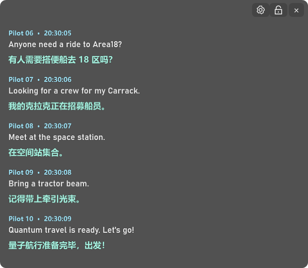
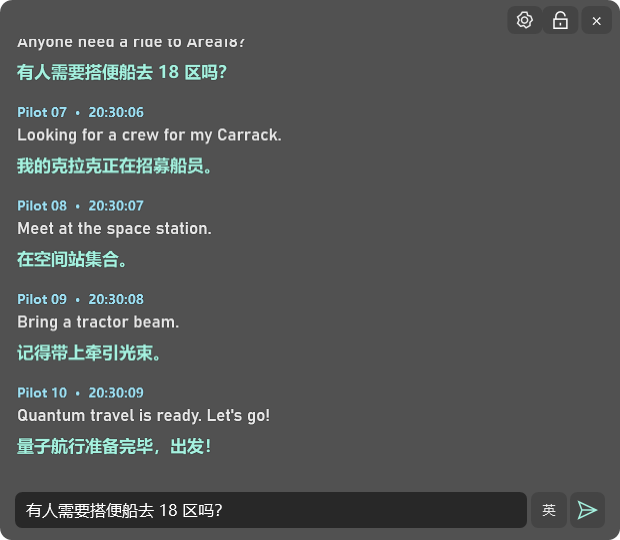
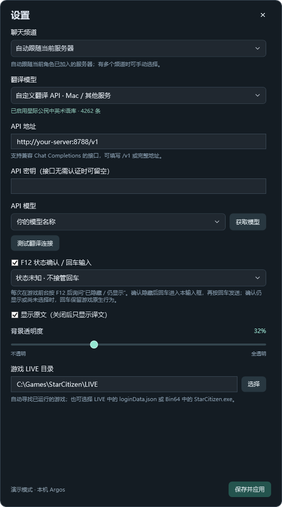

# 星际公民聊天翻译 · SCChatTranslator

面向《星际公民》的 Windows 聊天翻译工具。通过独立透明浮窗显示公开频道消息及中文译文，支持中文输入、英文翻译发送、本地模型与自定义翻译 API。

**[下载最新版 EXE](https://github.com/LouieLumi/SCChatTranslator/releases/latest/download/SCChatTranslator.exe)** · [版本与校验文件](https://github.com/LouieLumi/SCChatTranslator/releases) · [离线配图说明](https://github.com/LouieLumi/SCChatTranslator/releases/latest/download/usage.html)

## 免责声明

本项目是独立开发的非官方工具，与 Cloud Imperium Games（CIG）、Roberts Space Industries（RSI）无隶属或合作关系，不代表官方立场，也未获得官方认可或支持。

- **使用风险：** 使用前请自行了解并遵守游戏服务条款及第三方软件相关政策。本项目不保证使用本工具不会触发风控、功能限制、账号暂停或封禁；是否使用及相关风险由使用者自行判断和承担。
- **责任限制：** 在适用法律允许的范围内，开发者及贡献者不对因使用或无法使用本工具产生的账号限制、暂停或封禁、数据丢失及其他损失承担责任，亦不提供解封或损失赔偿承诺。
- **账号安全：** 请妥善保管游戏登录文件、会话令牌、API 密钥及个人配置，不要公开上传或向不可信第三方提供这些信息；自定义翻译 API 应使用可信服务。
- **软件保证：** 软件按“现状”提供，不对持续可用性、兼容性、翻译准确性或账号安全作出保证。游戏更新、服务接口或政策变化可能导致功能失效。

## 程序介绍



*界面使用示例聊天展示。*

- **聊天翻译**：读取当前角色已加入的公开服务器频道，显示原文与中文译文，支持关闭原文显示。
- **中文处理**：直接显示中文消息，并利用本机汉化字库解析兼容的社区输入编码。
- **消息发送**：支持中文编码发送，以及中文翻译为英文后发送；通过“中 / 英”按钮切换。
- **透明浮窗**：支持移动、缩放、锁定置顶、背景透明度调整和系统托盘后台运行。
- **输入联动**：通过 F12 确认原生聊天框状态，按回车打开输入框、发送或收起。
- **翻译引擎**：内置 Argos 中英双向模型与 4,262 条精选游戏术语，支持本地 Hy-MT3 和兼容 Chat Completions 的 API。

## 使用方法

### 1. 下载与启动

运行环境为 **Windows 10 / 11 x64**。游戏建议使用**无边框窗口**模式，以便浮窗置顶显示。

1. 从 [最新 Release](https://github.com/LouieLumi/SCChatTranslator/releases/latest) 下载 `SCChatTranslator.exe`。
2. 使用 RSI Launcher 正常登录游戏并进入服务器。
3. 双击 EXE，等待首次启动完成运行环境和内置模型的准备。
4. 程序自动寻找运行中的游戏目录。未识别到时，打开齿轮设置，在“游戏 LIVE 目录”中选择 LIVE 下的 `loginData.json`，或 `Bin64` 下的 `StarCitizen.exe`。
5. 默认选择“自动跟随当前服务器”。账号返回多个公开频道时，在设置中选择对应频道。

程序以单个 EXE 分发，无需另行安装 Python。更新时退出程序，再替换 EXE；个人设置保留在本机用户目录中。

### 2. 调整浮窗

| 控件或操作 | 功能 |
|---|---|
| 齿轮按钮 | 打开频道、模型、透明度、原文显示及快捷键设置 |
| 锁图标 | 切换锁定 / 解锁；解锁后拖动窗口上沿移动，拖动边缘缩放 |
| 右上角 × | 隐藏到系统托盘，继续后台读取 |
| 托盘图标 | 双击恢复窗口；右键可打开设置或退出程序 |
| 鼠标移到右上角 | 显示三个控制按钮；移开 3 秒后淡出 |
| 鼠标滚轮 | 查看历史消息，同时显示滚动条；停止 3 秒后淡出 |
| “↓ 最新” | 回到最新消息并继续跟随更新 |

锁定与解锁状态均保持置顶。背景透明度只调整背景，文字保持清晰。滚动条默认隐藏，消息自动滚动时不会显示。

### 3. 输入与发送



点击本程序窗口后按 **Enter** 可打开输入框。在游戏前台使用回车输入时，先按下一节开启 F12 联动。

| 操作 | 行为 |
|---|---|
| 输入框隐藏时按 Enter | 展开并聚焦输入框，恢复未发送的草稿 |
| 点击“中 / 英” | 直接切换发送语言 |
| 有内容时按 Enter 或点击箭头 | 立即收起输入框并交回游戏焦点，后台继续翻译和发送 |
| 内容为空或只有空白时按 Enter | 收起输入框 |
| 按 Esc、点击回到游戏或切换窗口 | 收起输入框并保留草稿 |
| 发送失败 | 保留草稿；下次打开输入框查看错误，不抢回游戏焦点 |

输入时键盘焦点留在输入框，支持中文输入法、复制粘贴和方向键编辑，Tab 与功能键不会跳离输入框。回车选词不提交消息；结束输入时等本次按键松开后交回游戏，避免长按回车再次触发游戏聊天。Alt+Tab 或点击其他窗口仍可主动切换。

**“中”模式**按本机汉化字库生成社区输入编码。接收方需要加载兼容的社区输入法码表才能显示中文；缺少对应码表时可能显示编码。

**“英”模式**将中文翻译成英文后发送；英文输入直接发送。API 或本地 Hy 不可用时回退到内置 Argos，翻译不完整时保留草稿。

发送目标为当前所选公开频道。发生网络超时时，应先查看频道是否已收到消息，再决定是否重发。

### 4. 设置 F12 联动

1. 打开设置，勾选 **“F12 状态确认 / 回车输入”**，点击“保存并应用”。
2. 回到游戏按 **F12**，游戏切换原生聊天框后，程序弹出状态确认框。
3. 根据游戏画面选择“已隐藏”或“仍显示”。


| 确认状态 | 回车行为 |
|---|---|
| 已隐藏 | 打开本程序输入框，输入后再次回车发送 |
| 仍显示 | 使用游戏原生输入框 |
| 状态未知或尚未选择 | 保留游戏原生输入行为 |

每次在游戏前台按 F12 都会询问。程序或游戏重启后需要重新确认；通过游戏菜单改变聊天框状态后，可重新确认或在设置中修正。

### 5. 选择翻译模型


| 模式 | 运行方式 | 配置要求 |
|---|---|---|
| Argos 中英双向 1.9 | Windows CPU，本地离线翻译 | 模型已内置，默认启用 |
| Hy-MT3 1.8B | Windows CPU，2 个推理线程 | 首次下载约 1.35 GB 模型及约 25 MB 运行组件 |
| 自定义翻译 API | 调用 Mac 或其他服务器上的模型 | 填写接口地址、模型名称及所需密钥 |

本地 Hy 准备期间或 API 调用失败时回退到 Argos。设置调整完成后点击“保存并应用”。

自定义 API 的配置步骤：

1. 选择“自定义翻译 API · Mac / 其他服务”。
2. 填写兼容 Chat Completions 的服务地址，可填写 `/v1` 或完整的 `/v1/chat/completions` 地址。
3. 填写所需密钥，点击“获取模型”选择模型，或直接输入模型名称。
4. 点击“测试翻译连接”，成功后保存。

<details>
<summary>API 设置示意图</summary>



</details>

## 实现原理

### 会话鉴权与频道获取

程序从本机所选 LIVE 目录的 `loginData.json` 读取登录会话及服务地址，校验官方服务域名后建立 TLS/gRPC 连接。通过身份服务取得当前角色会话，再通过社交服务查询该角色已加入的公开服务器频道。

登录文件发生变化或会话即将过期时，客户端重新鉴权；频道列表定期刷新。游戏会话令牌保存在运行内存中，频道选择保存在本机应用配置中。

### 消息读取与中文解码

后台定期读取所选频道的消息，按消息 ID 合并新增、编辑和删除记录，再将结果交给界面增量更新。查看历史消息时保留滚动位置，跟随最新消息时自动滚动到底部。

中文消息直接显示。对于 `[zh] @…` 社区输入编码，解码器读取本机已有的 `data/Localization/chinese_(simplified)/global.ini`，根据字符映射还原文本；未识别的编码保留原文。

### 翻译处理

外语消息经翻译路由器分发至 Argos、本地 Hy-MT3 或自定义 API。术语匹配模块提供游戏专有名词参考：Hy/API 将匹配词条加入翻译提示，Argos 结合整句翻译与保守术语修正。

本地模型在 Windows CPU 上运行。选择远程 API 时，待翻译文字和匹配术语发送到所配置的服务。

### 消息发送

输入文本根据所选语言进行编码或翻译，再通过聊天服务提交。输入框在请求提交到本地后台后立即收起并交回游戏焦点，无需等待翻译或服务器回执。发送前重新检查当前账号是否仍在目标公开频道，成功回执清空已发送草稿；失败时保留草稿，后台结果不会抢回焦点。

发送请求不自动重试，过期请求和重启前遗留请求不会重放。中文编码格式参考 [SC 盒子社区输入编码器](https://github.com/StarCitizenToolBox/app/blob/main/lib/ui/home/input_method/input_method_encoder.dart)及其[码表加载逻辑](https://github.com/StarCitizenToolBox/app/blob/main/lib/ui/home/localization/localization_ui_model.dart)。

### 桌面界面与打包

界面使用 C# / WPF，消息读取和翻译由独立 Python 后台完成。F12 联动通过 Windows 键盘事件和用户确认维护状态，回车行为随该状态切换。程序作为独立桌面进程运行，游戏文件仅用于读取登录信息和汉化字库。

单文件启动器内嵌运行环境、依赖与 Argos 模型，启动时校验并展开到用户目录。个人设置、API 配置和临时聊天状态存放在 `%LOCALAPPDATA%\SCChatTranslator`；API 密钥目前以明文保存在该目录的个人配置中。

| 源码模块 | 职责 |
|---|---|
| [client.py](src/client.py) | 会话鉴权、频道查询、聊天读取与发送 |
| [backend.py](src/backend.py) | 消息轮询、状态合并和翻译调度 |
| [chat_decoder.py](src/chat_decoder.py) | 汉化编码解析与中文编码生成 |
| [translator_api.py](src/translator_api.py) | 翻译引擎选择、API 调用及回退 |
| [outgoing.py](src/outgoing.py) | 发送请求校验、状态处理与回执 |
| [App.cs](src/App.cs) / [GameHotkeys.cs](src/GameHotkeys.cs) | 浮窗交互、托盘及快捷键联动 |
| [Bootstrap.cs](src/Bootstrap.cs) | 单文件启动与运行环境展开 |

游戏服务接口未承诺对第三方兼容，游戏更新或权限变化可能影响读取与发送。本项目为非官方工具。

### 从源码构建

构建环境为 Windows x64、Python 3.12+ 和 .NET Framework 4.x 编译器：

```powershell
python tools/prepare.py
python tools/build.py
```

脚本下载并校验固定版本的运行依赖及模型，生成 `dist/SCChatTranslator.exe`。

使用 `SCChatTranslator.exe --demo` 可打开内置示例界面。示例译文用于展示界面效果。

## 许可与署名

- 本项目原创代码和图标：[MIT](LICENSE)。
- `src/glossary.json`：社区数据 **CC BY-NC-SA 4.0**，保留署名、非商业、相同方式共享；详情见 [词库说明](src/GLOSSARY-NOTICE.txt)。MIT 不重新授权该词库。
- Argos 中英双向模型源自 OPUS-MT，**CC BY 4.0**；Python 及运行依赖各自保留原许可；详见 [THIRD_PARTY_NOTICES.md](THIRD_PARTY_NOTICES.md)。
- 可选 Hy-MT3 模型 Apache 2.0，llama.cpp MIT，下载时保留上游随附许可。

Star Citizen、RSI 等商标和游戏内容属于相应权利人。仓库不分发游戏客户端、游戏汉化文件或账号凭据。
